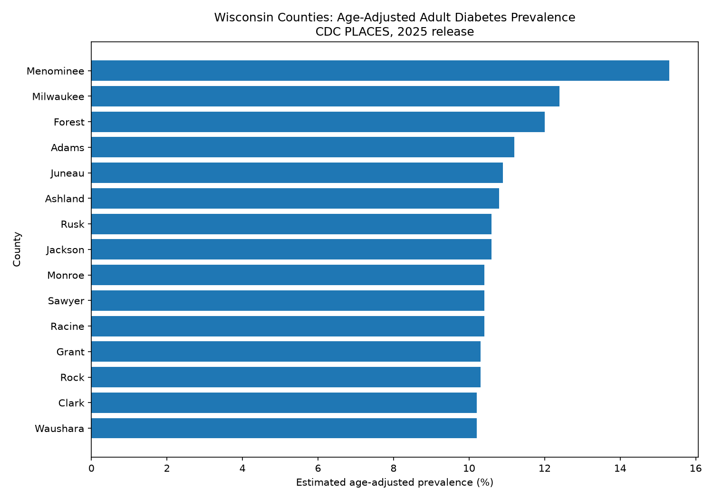

# Wisconsin Public Health Data Collector

## Overview

This project retrieves CDC PLACES county-level public health estimates for Wisconsin through the Socrata API. It demonstrates API pagination, data cleaning, quality checks, summary analysis, visualization, and documentation.



## Data source

**Dataset:** PLACES: County Data (GIS Friendly Format), 2025 release

**Publisher:** Centers for Disease Control and Prevention (CDC)

**Dataset page:** https://data.cdc.gov/d/i46a-9kgh

**API endpoint:** https://data.cdc.gov/resource/i46a-9kgh.json

**Geographic scope:** Wisconsin county records

The CDC PLACES estimates are model-based population-level estimates, not exact counts of individual residents. Interpret differences with care and consult CDC measure definitions and methodology.

## Run the project

Install dependencies:

```bash
pip install requests pandas matplotlib
```

Run from the project root:

```bash
python wi_places_collector.py
```
## Takeaways
All 72 Wisconsin counties were retrieved, and validation found no missing values, duplicate county IDs, or out-of-range estimates across 80 prevalence fields. Menominee County had the highest age-adjusted adult diabetes prevalence at 15.3%, nearly 3 percentage points above Milwaukee County (12.4%), the largest gap in the top 15. Menominee County shares its boundaries with the Menominee Indian Reservation, and several other high-ranking counties include tribal lands, which may be worth exploring alongside demographic and access-to-care data. High estimates appear in both urban counties (Milwaukee, Racine, Rock) and rural central and northern counties. Below the top three, estimates fall within about one percentage point of each other, so those rankings should not be over-read.

## Outputs

- `output/wi_places_raw.csv` — records as returned by the API.
- `output/wi_places_clean.csv` — cleaned fields and row-level QA flags.
- `output/quality_report.txt` — missingness, duplicate, range, and count checks.
- `output/wi_diabetes_age_adjusted_summary.csv` — county estimates sorted high to low.
- `output/wi_diabetes_age_adjusted.png` — chart of the 15 highest estimates.
- `README.md` — project overview and data dictionary (this file).

## Quality checks

The script checks whether exactly 72 Wisconsin county records were retrieved, identifies missing and duplicate county FIPS values, counts missing values, and checks crude and age-adjusted prevalence estimates for values outside 0–100. Suspect rows are flagged rather than silently removed. The current run's findings are included below.

```text
CDC PLACES DATA QUALITY REPORT
========================================
Dataset: PLACES: County Data (GIS Friendly Format), 2025 release
Source: https://data.cdc.gov/d/i46a-9kgh
State filter: WI
Records retrieved: 72
Expected Wisconsin county records: 72 (PASS)
Columns after cleaning: 169
Missing cells across all source columns: 0
Missing county FIPS values: 0
Rows involved in duplicate county IDs: 0
Duplicate county IDs beyond first occurrence: 0
Prevalence columns checked: 80
Missing prevalence cells: 0
Out-of-range prevalence cells: 0
Rows with out-of-range prevalence: 0
Rows with one or more row-level flags: 0

Missing values and flagged records are retained for review.
Prevalence range checks assume percentage estimates from 0 to 100.
Confidence-interval fields ending in _95ci remain text and are not parsed.

Columns with the most missing values:
  stateabbr: 0
  statedesc: 0
  countyname: 0
  countyfips: 0
  totalpopulation: 0
  totalpop18plus: 0
  access2_crudeprev: 0
  access2_crude95ci: 0
  access2_adjprev: 0
  access2_adj95ci: 0
```

## Analysis choice

The county ranking uses `diabetes_adjprev` (age-adjusted prevalence), rather than `diabetes_crudeprev` (crude prevalence). Crude prevalence can partly reflect differences in county age structure. Age adjustment helps make comparisons between populations with different age distributions more meaningful, though it does not remove every source of uncertainty or confounding.

The chart shows the 15 counties with the highest valid age-adjusted estimates. This is a descriptive comparison, not evidence that small differences between counties are statistically meaningful.

## Limitations

- This project downloads Wisconsin records only.
- CDC PLACES estimates are model-based and are subject to uncertainty.
- Confidence-interval columns ending in `_95ci` contain text such as `(9.1, 10.2)`. They are preserved as text, not parsed, and are not used in the ranking or chart.
- Missing values are reported rather than imputed.
- Rows with detected issues are flagged rather than automatically deleted.
- The prevalence range check assumes estimates are percentages from 0 to 100.
- A ranking by point estimate alone does not establish statistically meaningful differences between counties.

## Data dictionary

Source fields below are documented using the dataset metadata retrieved from Socrata. Confidence-interval fields are text fields and are not used in the county ranking.

| Field | Description |
|---|---|
| `stateabbr` (StateAbbr) | State abbreviation |
| `statedesc` (StateDesc) | State name |
| `countyname` (CountyName) | County name |
| `countyfips` (CountyFIPS) | County FIPS code |
| `totalpopulation` (TotalPopulation) | Total population of census 2023 estimates |
| `totalpop18plus` (TotalPop18plus) | Total population 18 and plus of census 2023 estimates |
| `access2_crudeprev` (ACCESS2_CrudePrev) | Model-based estimate for crude prevalence of current lack of health insurance among adults aged 18-64 years, 2023 |
| `access2_crude95ci` (ACCESS2_Crude95CI) | Estimated confidence interval for crude prevalence of lack of health insurance among adults aged 18-64 years |
| `access2_adjprev` (ACCESS2_AdjPrev) | Model-based estimate for age-adjusted prevalence of lack of health insurance among adults aged 18-64 years, 2023 |
| `access2_adj95ci` (ACCESS2_Adj95CI) | Estimated confidence interval for age-adjusted prevalence of lack of health insurance among adults aged 18-64 years |
| `arthritis_crudeprev` (ARTHRITIS_CrudePrev) | Model-based estimate for crude prevalence of arthritis among adults, 2023 |
| `arthritis_crude95ci` (ARTHRITIS_Crude95CI) | Estimated confidence interval for crude prevalence of arthritis among adults |
| `arthritis_adjprev` (ARTHRITIS_AdjPrev) | Model-based estimate for age-adjusted prevalence of arthritis among adults, 2023 |
| `arthritis_adj95ci` (ARTHRITIS_Adj95CI) | Estimated confidence interval for age-adjusted prevalence estimate of arthritis among adults |
| `binge_crudeprev` (BINGE_CrudePrev) | Model-based estimate for crude prevalence of binge drinking among adults, 2023 |
| `binge_crude95ci` (BINGE_Crude95CI) | Estimated confidence interval for crude prevalence of binge drinking among adults |
| `binge_adjprev` (BINGE_AdjPrev) | Model-based estimate for age-adjusted prevalence of binge drinking among adults, 2023 |
| `binge_adj95ci` (BINGE_Adj95CI) | Estimated confidence interval for age-adjusted prevalence of binge drinking among adults |
| `bphigh_crudeprev` (BPHIGH_CrudePrev) | Model-based estimate for crude prevalence of high blood pressure among adults, 2023 |
| `bphigh_crude95ci` (BPHIGH_Crude95CI) | Estimated confidence interval for crude prevalence of high blood pressure among adults |
| `bphigh_adjprev` (BPHIGH_AdjPrev) | Model-based estimate for age-adjusted prevalence of high blood pressure among adults, 2023 |
| `bphigh_adj95ci` (BPHIGH_Adj95CI) | Estimated confidence interval for age-adjusted prevalence of high blood pressure among adults |
| `bpmed_crudeprev` (BPMED_CrudePrev) | Model-based estimate for crude prevalence of taking medicine to control high blood pressure among adults with high blood pressure, 2023 |
| `bpmed_crude95ci` (BPMED_Crude95CI) | Estimated confidence interval for crude prevalence of taking medicine to control high blood pressure among adults with high blood pressure |
| `bpmed_adjprev` (BPMED_AdjPrev) | Model-based estimate for age-adjusted prevalence of taking medicine to control high blood pressure among adults with high blood pressure, 2023 |
| `bpmed_adj95ci` (BPMED_Adj95CI) | Estimated confidence interval for age-adjusted prevalence of taking medicine to control high blood pressure among adults with high blood pressure |
| `cancer_crudeprev` (CANCER_CrudePrev) | Model-based estimate for crude prevalence of cancer (non-skin) or melanoma among adults, 2023 |
| `cancer_crude95ci` (CANCER_Crude95CI) | Estimated confidence interval for crude prevalence of cancer (non-skin) or melanoma among adults |
| `cancer_adjprev` (CANCER_AdjPrev) | Model-based estimate for age-adjusted prevalence of cancer (non-skin) or melanoma among adults, 2023 |
| `cancer_adj95ci` (CANCER_Adj95CI) | Estimated confidence interval for age-adjusted prevalence of cancer (non-skin) or melanoma among adults |
| `casthma_crudeprev` (CASTHMA_CrudePrev) | Model-based estimate for crude prevalence of current asthma among adults, 2023 |
| `casthma_crude95ci` (CASTHMA_Crude95CI) | Estimated confidence interval for crude prevalence of current asthma among adults |
| `casthma_adjprev` (CASTHMA_AdjPrev) | Model-based estimate for age-adjusted prevalence of current asthma among adults, 2023 |
| `casthma_adj95ci` (CASTHMA_Adj95CI) | Estimated confidence interval for age-adjusted prevalence of current asthma among adults |
| `chd_crudeprev` (CHD_CrudePrev) | Model-based estimate for crude prevalence of coronary heart disease among adults, 2023 |
| `chd_crude95ci` (CHD_Crude95CI) | Estimated confidence interval for crude prevalence of coronary heart disease among adults |
| `chd_adjprev` (CHD_AdjPrev) | Model-based estimate for age-adjusted prevalence of coronary heart disease among adults, 2023 |
| `chd_adj95ci` (CHD_Adj95CI) | Estimated confidence interval for age-adjusted prevalence of coronary heart disease among adults |
| `checkup_crudeprev` (CHECKUP_CrudePrev) | Model-based estimate for crude prevalence of routine checkup within the past year among adults, 2023 |
| `checkup_crude95ci` (CHECKUP_Crude95CI) | Estimated confidence interval for crude prevalence of routine checkup within the past year among adults |
| `checkup_adjprev` (CHECKUP_AdjPrev) | Model-based estimate for age-adjusted prevalence of routine checkup within the past year among adults, 2023 |
| `checkup_adj95ci` (CHECKUP_Adj95CI) | Estimated confidence interval for age-adjusted prevalence of routine checkup within the past year among adults |
| `cholscreen_crudeprev` (CHOLSCREEN_CrudePrev) | Model-based estimate for crude prevalence of cholesterol screening within the past 5 years among adults, 2023 |
| `cholscreen_crude95ci` (CHOLSCREEN_Crude95CI) | Estimated confidence interval for crude prevalence of cholesterol screening within the past 5 years among adults  |
| `cholscreen_adjprev` (CHOLSCREEN_AdjPrev) | Model-based estimate for age-adjusted prevalence of cholesterol screening within the past 5 years among adults, 2023 |
| `cholscreen_adj95ci` (CHOLSCREEN_Adj95CI) | Estimated confidence interval for age-adjusted prevalence of cholesterol screening within the past 5 years among adults  |
| `colon_screen_crudeprev` (COLON_SCREEN_CrudePrev) | Model-based estimate for crude prevalence of colorectal cancer screening among adults aged 45–75 years, 2022 |
| `colon_screen_crude95ci` (COLON_SCREEN_Crude95CI) | Estimated confidence interval for crude prevalence of colorectal cancer screening among adults aged 45–75 years |
| `colon_screen_adjprev` (COLON_SCREEN_AdjPrev) | Model-based estimate for age-adjusted prevalence of colorectal cancer screening among adults aged 45–75 years, 2022 |
| `colon_screen_adj95ci` (COLON_SCREEN_Adj95CI) | Estimated confidence interval for age-adjusted prevalence of colorectal cancer screening among adults aged 45–75 years |
| `copd_crudeprev` (COPD_CrudePrev) | Model-based estimate for crude prevalence of chronic obstructive pulmonary disease among adults, 2023 |
| `copd_crude95ci` (COPD_Crude95CI) | Estimated confidence interval for crude prevalence of chronic obstructive pulmonary disease among adults |
| `copd_adjprev` (COPD_AdjPrev) | Model-based estimate for age-adjusted prevalence of chronic obstructive pulmonary disease among adults, 2023 |
| `copd_adj95ci` (COPD_Adj95CI) | Estimated confidence interval for age-adjusted prevalence of chronic obstructive pulmonary disease among adults |
| `csmoking_crudeprev` (CSMOKING_CrudePrev) | Model-based estimate for crude prevalence of current cigarette smoking among adults, 2023 |
| `csmoking_crude95ci` (CSMOKING_Crude95CI) | Estimated confidence interval for crude prevalence of current cigarette smoking among adults |
| `csmoking_adjprev` (CSMOKING_AdjPrev) | Model-based estimate for age-adjusted prevalence of current cigarette smoking among adults, 2023 |
| `csmoking_adj95ci` (CSMOKING_Adj95CI) | Estimated confidence interval for age-adjusted prevalence of current cigarette smoking among adults  |
| `dental_crudeprev` (DENTAL_CrudePrev) | Model-based estimate for crude prevalence of visited dentist or dental clinic in the past year among adults, 2022 |
| `dental_crude95ci` (DENTAL_Crude95CI) | Estimated confidence interval for crude prevalence of visited dentist or dental clinic in the past year among adults  |
| `dental_adjprev` (DENTAL_AdjPrev) | Model-based estimate for age-adjusted prevalence of visited dentist or dental clinic in the past year among adults, 2022 |
| `dental_adj95ci` (DENTAL_Adj95CI) | Estimated confidence interval for age-adjusted prevalence of visited dentist or dental clinic in the past year among adults |
| `depression_crudeprev` (DEPRESSION_CrudePrev) | Model-based estimate for crude prevalence of depression among adults, 2023 |
| `depression_crude95ci` (DEPRESSION_Crude95CI) | Estimated confidence interval for crude prevalence of depression among adults |
| `depression_adjprev` (DEPRESSION_AdjPrev) | Model-based estimate for age-adjusted prevalence of depression among adults, 2023 |
| `depression_adj95ci` (DEPRESSION_Adj95CI) | Estimated confidence interval for age-adjusted prevalence of depression among adults |
| `diabetes_crudeprev` (DIABETES_CrudePrev) | Model-based estimate for crude prevalence of diagnosed diabetes among adults, 2023 |
| `diabetes_crude95ci` (DIABETES_Crude95CI) | Estimated confidence interval for crude prevalence of diagnosed diabetes among adults |
| `diabetes_adjprev` (DIABETES_AdjPrev) | Model-based estimate for age-adjusted prevalence of diagnosed diabetes among adults, 2023 |
| `diabetes_adj95ci` (DIABETES_Adj95CI) | Estimated confidence interval for age-adjusted prevalence of diagnosed diabetes among adults |
| `ghlth_crudeprev` (GHLTH_CrudePrev) | Model-based estimate for crude prevalence of fair or poor health among adults, 2023 |
| `ghlth_crude95ci` (GHLTH_Crude95CI) | Estimated confidence interval for crude prevalence of fair or poor health among adults |
| `ghlth_adjprev` (GHLTH_AdjPrev) | Model-based estimate for age-adjusted prevalence of fair or poor health among adults, 2023 |
| `ghlth_adj95ci` (GHLTH_Adj95CI) | Estimated confidence interval for age-adjusted prevalence of fair or poor health among adults |
| `highchol_crudeprev` (HIGHCHOL_CrudePrev) | Model-based estimate for crude prevalence of high cholesterol among adults who have ever been screened, 2023 |
| `highchol_crude95ci` (HIGHCHOL_Crude95CI) | Estimated confidence interval for crude prevalence of high cholesterol among adults who have ever been screened |
| `highchol_adjprev` (HIGHCHOL_AdjPrev) | Model-based estimate for age-adjusted prevalence of high cholesterol among adults who have ever been screened, 2023 |
| `highchol_adj95ci` (HIGHCHOL_Adj95CI) | Estimated confidence interval for age-adjusted prevalence of high cholesterol among adults who have ever been screened |
| `lpa_crudeprev` (LPA_CrudePrev) | Model-based estimate for crude prevalence of no leisure-time physical activity among adults, 2023 |
| `lpa_crude95ci` (LPA_Crude95CI) | Estimated confidence interval for crude prevalence of no leisure-time physical activity among adults |
| `lpa_adjprev` (LPA_AdjPrev) | Model-based estimate for age-adjusted prevalence of no leisure-time physical activity among adults, 2023 |
| `lpa_adj95ci` (LPA_Adj95CI) | Estimated confidence interval for age-adjusted prevalence of no leisure-time physical activity among adults |
| `mammouse_crudeprev` (MAMMOUSE_CrudePrev) | Model-based estimate for crude prevalence of mammography use among women aged 50–74 years, 2022 |
| `mammouse_crude95ci` (MAMMOUSE_Crude95CI) | Estimated confidence interval for crude prevalence of mammography use among women aged 50–74 years |
| `mammouse_adjprev` (MAMMOUSE_AdjPrev) | Model-based estimate for age-adjusted prevalence of mammography use among women aged 50–74 years, 2022 |
| `mammouse_adj95ci` (MAMMOUSE_Adj95CI) | Estimated confidence interval for age-adjusted prevalence of mammography use among women aged 50–74 years |
| `mhlth_crudeprev` (MHLTH_CrudePrev) | Model-based estimate for crude prevalence of frequent mental distress among adults, 2023 |
| `mhlth_crude95ci` (MHLTH_Crude95CI) | Estimated confidence interval for crude prevalence of frequent mental distress among adults  |
| `mhlth_adjprev` (MHLTH_AdjPrev) | Model-based estimate for age-adjusted prevalence of frequent mental distress among adults, 2023 |
| `mhlth_adj95ci` (MHLTH_Adj95CI) | Estimated confidence interval for age-adjusted prevalence of frequent mental distress among adults  |
| `obesity_crudeprev` (OBESITY_CrudePrev) | Model-based estimate for crude prevalence of obesity among adults, 2023 |
| `obesity_crude95ci` (OBESITY_Crude95CI) | Estimated confidence interval for crude prevalence of obesity among adults |
| `obesity_adjprev` (OBESITY_AdjPrev) | Model-based estimate for age-adjusted prevalence of obesity among adults, 2023 |
| `obesity_adj95ci` (OBESITY_Adj95CI) | Estimated confidence interval for age-adjusted prevalence of obesity among adults |
| `phlth_crudeprev` (PHLTH_CrudePrev) | Model-based estimate for crude prevalence of frequent physical distress among adults, 2023 |
| `phlth_crude95ci` (PHLTH_Crude95CI) | Estimated confidence interval for crude prevalence of frequent physical distress among adults  |
| `phlth_adjprev` (PHLTH_AdjPrev) | Model-based estimate for age-adjusted prevalence of frequent physical distress among adults, 2023 |
| `phlth_adj95ci` (PHLTH_Adj95CI) | Estimated confidence interval for age-adjusted prevalence of frequent physical distress among adults |
| `sleep_crudeprev` (SLEEP_CrudePrev) | Model-based estimate for crude prevalence of short sleep duration among adults, 2022 |
| `sleep_crude95ci` (SLEEP_Crude95CI) | Estimated confidence interval for crude prevalence of short sleep duration among adults |
| `sleep_adjprev` (SLEEP_AdjPrev) | Model-based estimate for age-adjusted prevalence of short sleep duration among adults, 2022 |
| `sleep_adj95ci` (SLEEP_Adj95CI) | Estimated confidence interval for age-adjusted prevalence of short sleep duration among adults  |
| `stroke_crudeprev` (STROKE_CrudePrev) | Model-based estimate for crude prevalence of stroke among adults, 2023 |
| `stroke_crude95ci` (STROKE_Crude95CI) | Estimated confidence interval for crude prevalence of stroke among adults |
| `stroke_adjprev` (STROKE_AdjPrev) | Model-based estimate for age-adjusted prevalence of stroke among adults, 2023 |
| `stroke_adj95ci` (STROKE_Adj95CI) | Estimated confidence interval for age-adjusted prevalence of stroke among adults |
| `teethlost_crudeprev` (TEETHLOST_CrudePrev) | Model-based estimate for crude prevalence of all teeth lost among adults aged >=65 years, 2022 |
| `teethlost_crude95ci` (TEETHLOST_Crude95CI) | Estimated confidence interval for crude prevalence of all teeth lost among adults aged >=65 years |
| `teethlost_adjprev` (TEETHLOST_AdjPrev) | Model-based estimate for age-adjusted prevalence of all teeth lost among adults aged >=65 years, 2022 |
| `teethlost_adj95ci` (TEETHLOST_Adj95CI) | Estimated confidence interval for age-adjusted prevalence of all teeth lost among adults aged >=65 years |
| `hearing_crudeprev` (HEARING_CrudePrev) | Model-based estimate for crude prevalence of hearing disability among adults, 2023 |
| `hearing_crude95ci` (HEARING_Crude95CI) | Estimated confidence interval for crude prevalence of hearing disability among adults |
| `hearing_adjprev` (HEARING_AdjPrev) | Model-based estimate for age-adjusted prevalence of hearing disability among adults, 2023 |
| `hearing_adj95ci` (HEARING_Adj95CI) | Estimated confidence interval for age-adjusted prevalence of hearing disability among adults |
| `vision_crudeprev` (VISION_CrudePrev) | Model-based estimate for crude prevalence of vision disability among adults, 2023 |
| `vision_crude95ci` (VISION_Crude95CI) | Estimated confidence interval for crude prevalence of vision disability among adults |
| `vision_adjprev` (VISION_AdjPrev) | Model-based estimate for age-adjusted prevalence of vision disability among adults, 2023 |
| `vision_adj95ci` (VISION_Adj95CI) | Estimated confidence interval for age-adjusted prevalence of vision disability among adults |
| `cognition_crudeprev` (COGNITION_CrudePrev) | Model-based estimate for crude prevalence of cognitive disability among adults, 2023 |
| `cognition_crude95ci` (COGNITION_Crude95CI) | Estimated confidence interval for crude prevalence of cognitive disability among adults |
| `cognition_adjprev` (COGNITION_AdjPrev) | Model-based estimate for age-adjusted prevalence of cognitive disability among adults, 2023 |
| `cognition_adj95ci` (COGNITION_Adj95CI) | Estimated confidence interval for age-adjusted prevalence of cognitive disability among adults |
| `mobility_crudeprev` (MOBILITY_CrudePrev) | Model-based estimate for crude prevalence of mobility disability among adults, 2023 |
| `mobility_crude95ci` (MOBILITY_Crude95CI) | Estimated confidence interval for crude prevalence of mobility disability among adults |
| `mobility_adjprev` (MOBILITY_AdjPrev) | Model-based estimate for age-adjusted prevalence of mobility disability among adults, 2023 |
| `mobility_adj95ci` (MOBILITY_Adj95CI) | Estimated confidence interval for age-adjusted prevalence of mobility disability among adults |
| `selfcare_crudeprev` (SELFCARE_CrudePrev) | Model-based estimate for crude prevalence of self-care disability among adults, 2023 |
| `selfcare_crude95ci` (SELFCARE_Crude95CI) | Estimated confidence interval for crude prevalence of self-care disability among adults |
| `selfcare_adjprev` (SELFCARE_AdjPrev) | Model-based estimate for age-adjusted prevalence of self-care disability among adults, 2023 |
| `selfcare_adj95ci` (SELFCARE_Adj95CI) | Estimated confidence interval for age-adjusted prevalence of self-care disability among adults |
| `indeplive_crudeprev` (INDEPLIVE_CrudePrev) | Model-based estimate for crude prevalence of independent living disability among adults, 2023 |
| `indeplive_crude95ci` (INDEPLIVE_Crude95CI) | Estimated confidence interval for crude prevalence of independent living disability among adults |
| `indeplive_adjprev` (INDEPLIVE_AdjPrev) | Model-based estimate for age-adjusted prevalence of independent living disability among adults, 2023 |
| `indeplive_adj95ci` (INDEPLIVE_Adj95CI) | Estimated confidence interval for age-adjusted prevalence of independent living disability among adults |
| `disability_crudeprev` (DISABILITY_CrudePrev) | Model-based estimate for crude prevalence of any disability among adults, 2023 |
| `disability_crude95ci` (DISABILITY_Crude95CI) | Estimated confidence interval for crude prevalence of any disability among adults |
| `disability_adjprev` (DISABILITY_AdjPrev) | Model-based estimate for age-adjusted prevalence of any disability among adults, 2023 |
| `disability_adj95ci` (DISABILITY_Adj95CI) | Estimated confidence interval for age-adjusted prevalence of any disability among adults |
| `loneliness_crudeprev` (LONELINESS_CrudePrev) | Model-based estimate for crude prevalence of feeling socially isolated among adults, 2023 |
| `loneliness_crude95ci` (LONELINESS_Crude95CI) | Estimated confidence interval for crude prevalence of feeling socially isolated among adults  |
| `loneliness_adjprev` (LONELINESS_AdjPrev) | Model-based estimate for age-adjusted prevalence of feeling socially isolated among adults, 2023 |
| `loneliness_adj95ci` (LONELINESS_Adj95CI) | Estimated confidence interval for age-adjusted prevalence of feeling socially isolated among adults |
| `foodstamp_crudeprev` (FOODSTAMP_CrudePrev) | Model-based estimate for crude prevalence of received food stamps in the past 12 months among adults, 2023 |
| `foodstamp_crude95ci` (FOODSTAMP_Crude95ci) | Estimated confidence interval for crude prevalence of received food stamps in the past 12 months among adults  |
| `foodstamp_adjprev` (FOODSTAMP_AdjPrev) | Model-based estimate for age-adjusted prevalence of received food stamps in the past 12 months among adults, 2023 |
| `foodstamp_adj95ci` (FOODSTAMP_Adj95CI) | Estimated confidence interval for age-adjusted prevalence of received food stamps in the past 12 months among adults  |
| `foodinsecu_crudeprev` (FOODINSECU_CrudePrev) | Model-based estimate for crude prevalence of food insecurity in the past 12 months among adults, 2023 |
| `foodinsecu_crude95ci` (FOODINSECU_Crude95CI) | Estimated confidence interval for crude prevalence of food insecurity in the past 12 months among adults  |
| `foodinsecu_adjprev` (FOODINSECU_AdjPrev) | Model-based estimate for age-adjusted prevalence of food insecurity in the past 12 months among adults, 2023 |
| `foodinsecu_adj95ci` (FOODINSECU_Adj95CI) | Estimated confidence interval for age-adjusted prevalence of food insecurity in the past 12 months among adults  |
| `housinsecu_crudeprev` (HOUSINSECU_CrudePrev) | Model-based estimate for crude prevalence of housing insecurity in the past 12 months among adults, 2023 |
| `housinsecu_crude95ci` (HOUSINSECU_Crude95CI) | Estimated confidence interval for crude prevalence of housing insecurity in the past 12 months among adults  |
| `housinsecu_adjprev` (HOUSINSECU_AdjPrev) | Model-based estimate for age-adjusted prevalence of housing insecurity in the past 12 months among adults, 2023 |
| `housinsecu_adj95ci` (HOUSINSECU_Adj95CI) | Estimated confidence interval for age-adjusted prevalence of housing insecurity in the past 12 months among adults |
| `shututility_crudeprev` (SHUTUTILITY_CrudePrev) | Model-based estimate for crude prevalence of utility services threat in the past 12 months among adults, 2023 |
| `shututility_crude95ci` (SHUTUTILITY_Crude95CI) | Estimated confidence interval for crude prevalence of utility services threat in the past 12 months among adults  |
| `shututility_adjprev` (SHUTUTILITY_AdjPrev) | Model-based estimate for age-adjusted prevalence of utility services threat in the past 12 months among adults, 2023 |
| `shututility_adj95ci` (SHUTUTILITY_Adj95CI) | Estimated confidence interval for age-adjusted prevalence of utility services threat in the past 12 months among adults |
| `lacktrpt_crudeprev` (LACKTRPT_CrudePrev) | Model-based estimate for crude prevalence of lack of reliable transportation in the past 12 months among adults, 2023 |
| `lacktrpt_crude95ci` (LACKTRPT_Crude95CI) | Estimated confidence interval for crude prevalence of lack of reliable transportation in the past 12 months among adults  |
| `lacktrpt_adjprev` (LACKTRPT_AdjPrev) | Model-based estimate for age-adjusted prevalence of lack of reliable transportation in the past 12 months among adults, 2023 |
| `lacktrpt_adj95ci` (LACKTRPT_Adj95CI) | Estimated confidence interval for age-adjusted prevalence of lack of reliable transportation in the past 12 months among adults |
| `emotionspt_crudeprev` (EMOTIONSPT_CrudePrev) | Model-based estimate for crude prevalence of lack of social and emotional support among adults, 2023 |
| `emotionspt_crude95ci` (EMOTIONSPT_Crude95CI) | Estimated confidence interval for crude prevalence of lack of social and emotional support among adults |
| `emotionspt_adjprev` (EMOTIONSPT_AdjPrev) | Model-based estimate for age-adjusted prevalence of lack of social and emotional support among adults, 2023 |
| `emotionspt_adj95ci` (EMOTIONSPT_Adj95CI) | Estimated confidence interval for age-adjusted prevalence of lack of social and emotional support among adults  |
| `geolocation` (Geolocation) | Latitude, Longitude of county centroid (Format: Point(Longitude Latitude)) |

Additional fields added during validation:

- `quality_flags`: explanation of any detected row-level issues.
- `has_quality_issue`: whether a row has one or more quality flags.
